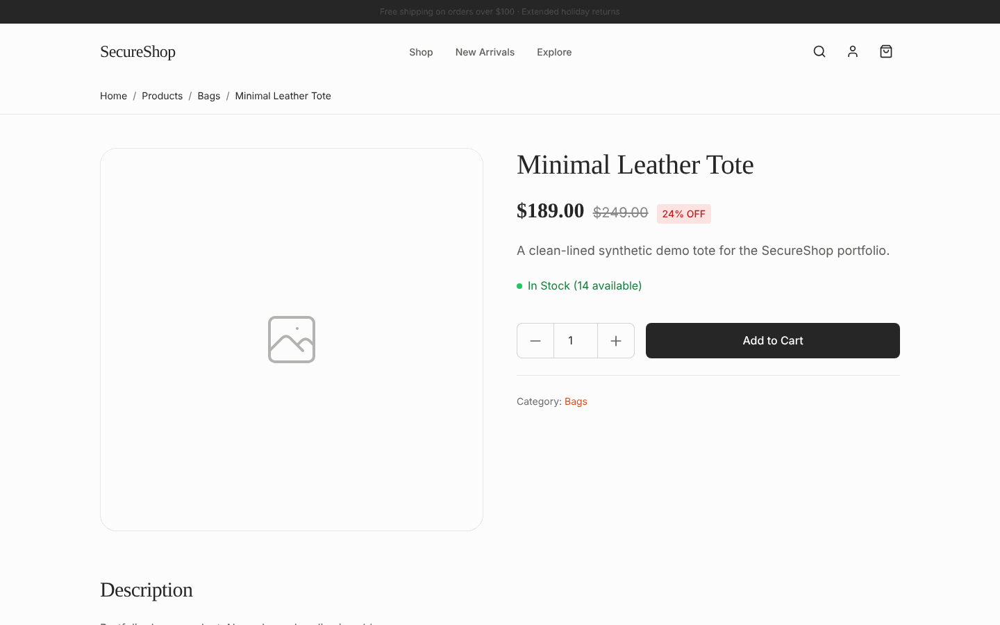
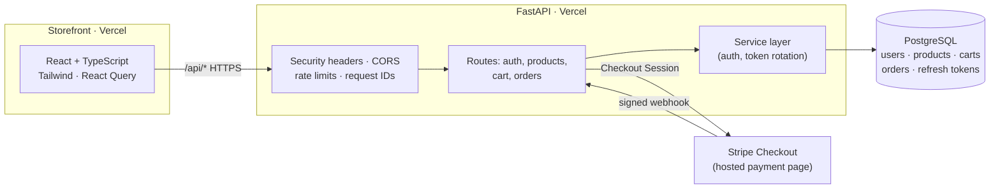

# SecureShop — Security-First E-Commerce with FastAPI, React & Stripe

[](LICENSE)

An open-source full-stack e-commerce reference project with a React/TypeScript storefront, Python/FastAPI backend, PostgreSQL and Stripe test-mode checkout. Explore practical web application security patterns inspired by the OWASP Top 10, including refresh-token rotation with reuse detection, role-based access control, rate limiting, safe money handling and idempotent payment workflows.

**Useful for:** developers learning secure REST API design, JWT authentication, Stripe webhook integration and concurrent order processing.

[](https://github.com/FarnazNK/secureshop-ecommerce/actions/workflows/ci.yml)
[](https://github.com/FarnazNK/secureshop-ecommerce/actions/workflows/security.yml)

**[🛍️ Live storefront](https://secureshop-storefront.vercel.app)** · **[📦 Catalog](https://secureshop-storefront.vercel.app/products)** · **[📘 API reference](https://secureshop-api.vercel.app/api/reference)** · **[💚 API health](https://secureshop-api.vercel.app/api/v1/health)**


---

## At a glance

| | |
| --- | --- |
| **What it is** | An online store: product catalog with search, filters and sorting, product pages, cart, accounts and orders |
| **Frontend** | React 18, TypeScript, Vite, Tailwind CSS, React Router, React Query |
| **Backend** | Python, FastAPI (async), SQLAlchemy 2.0, PostgreSQL, Alembic, Pydantic v2 |
| **Security** | JWT access + refresh tokens, token rotation with reuse detection, bcrypt, RBAC, rate limiting, CSP/HSTS headers |
| **Quality** | 71 backend tests (pytest), including concurrency tests against real PostgreSQL in CI; k6 load test with published results; Ruff lint/format, CodeQL, dependency audits |
| **Cost** | $0: free tiers only (Vercel Hobby, Neon free, Stripe test mode, GitHub Actions); everything else runs on your own computer |
| **Deployed on** | Vercel (storefront + API) with Neon PostgreSQL |

## Features

### 🔐 Authentication that handles stolen tokens
Access and refresh tokens are signed with **separate secrets**, and refresh tokens live in **HTTP-only, SameSite cookies**. Every refresh **rotates** the token, and if an already-used token is ever presented again, a sign it was stolen, **every session for that user is revoked**. Login runs bcrypt even when the email doesn't exist, so response timing can't reveal which emails are registered. Repeated failures trigger an account lockout.
→ [`backend/app/services/auth_service.py`](backend/app/services/auth_service.py)

### 🛡️ Hardened API
Security-headers middleware (CSP, HSTS in production, X-Frame-Options, Referrer-Policy, Permissions-Policy), explicit CORS origins, per-IP rate limits that are stricter on auth endpoints, Pydantic validation on every input, and an error handler that never leaks stack traces. Role-based access uses a declarative `require_role("admin")` dependency. The app **refuses to start** if a required secret is missing or shorter than 32 characters.
→ [`backend/app/middleware/`](backend/app/middleware/), [`backend/app/core/config.py`](backend/app/core/config.py)

### 💳 Orders and payments done safely
Money is stored as exact decimals (`Numeric(10, 2)`), never floats. Each order item **snapshots** the product name and price at purchase time, so receipts stay correct if the catalog changes. Card data never touches this site: checkout redirects to a **Stripe Checkout** page created server-side. Placing an order reserves stock; a **signature-verified Stripe webhook** marks the order paid, or cancels it and returns the stock if checkout expires. The webhook handler is idempotent (Stripe retries are safe), only accepts a session that belongs to the order, and refuses to mark an order paid if the amount or currency Stripe charged doesn't match the order total. A customer can't pay twice: "Pay now" reuses the open payment page instead of creating another.
→ [`backend/app/services/payments.py`](backend/app/services/payments.py), [`backend/app/api/v1/payments.py`](backend/app/api/v1/payments.py), [`backend/tests/test_payments.py`](backend/tests/test_payments.py)

### 🏋️ Holds up under load and failure
- **Never oversells.** Stock is taken with one conditional `UPDATE … WHERE stock >= n`, so 200 buyers racing for 50 units produce exactly 50 orders (tested on PostgreSQL and under k6 load).
- **No double orders.** Checkout sends an `Idempotency-Key`; a retry after a timeout or a double click returns the original order.
- **Stripe outages fail fast.** 10-second timeouts and a circuit breaker: after repeated failures checkout answers `503` in milliseconds with the cart kept, instead of hanging.
- **No lost payments.** Every webhook is stored before it's processed and retried if processing fails; an hourly job settles orders whose webhook never arrived, and a daily job reconciles Stripe against the database. Refunds and disputes update the order.
- **Overload is handled.** Shared rate limiting across instances (in the existing Postgres), a bounded connection pool that answers `503 Retry-After` instead of `500`, CDN-cacheable catalogue reads, alert rules, and a local autoscaler.

Design and trade-offs: [`docs/SCALING.md`](docs/SCALING.md). Load-test results: [`load/README.md`](load/README.md).

### 🛍️ Storefront
API-backed catalog with search, category and price filters and sorting kept in the URL (so filtered views are shareable), loading, empty and error states, product pages with stock info, and cart and account flows. Responsive and keyboard accessible.
→ [`frontend/src/pages/`](frontend/src/pages/)

### 🚀 CI/CD
GitHub Actions runs Ruff lint and format checks, applies Alembic migrations to a real **PostgreSQL 16** database, runs pytest with coverage alongside Redis, type-checks and builds the frontend, builds Docker images, and runs **CodeQL** plus dependency audits.
→ [`.github/workflows/`](.github/workflows/)

## Screenshots



## Architecture



Route handlers stay thin; business logic lives in `app/services/`, so it can be tested without an HTTP server. Pydantic schemas (the API contract) are kept separate from SQLAlchemy models (the database), so either can change without breaking the other.

## Run it locally

**With Docker** (Postgres, Redis, API and storefront)
```bash
cp .env.example .env            # fill in secrets: openssl rand -base64 48
docker compose up --build
docker compose run --rm migrate # apply database migrations once
# Storefront: http://localhost:8080 · API docs: http://localhost:3001/api/docs
```

**Without Docker**
```bash
cd backend
make dev && cp .env.example .env   # set DATABASE_URL and secrets
make migrate && make serve         # API on :3001
make test                          # pytest

cd ../frontend
npm install && npm run dev         # storefront on :5173
```

## API

| Area | Endpoints |
| --- | --- |
| Auth | `POST /api/v1/auth/register` · `login` · `refresh` · `logout` · `GET /api/v1/auth/me` |
| Products | `GET /api/v1/products` (filters, pagination) · `GET /{id}` · admin-only `POST` / `PATCH` / `DELETE` |
| Cart | `GET /api/v1/cart` · `POST /items` · `PATCH /items/{id}` · `DELETE /items/{id}` · `DELETE` |
| Orders | `POST /api/v1/orders` (reserves stock, returns a Stripe Checkout URL; honours `Idempotency-Key`) · `GET /api/v1/orders` · `GET /{id}` · `POST /{id}/checkout-session` (Pay now) · `POST /{id}/sync-payment` · `POST /{id}/refund` (admin) |
| Payments | `GET /api/v1/payments/config` · `POST /api/v1/payments/webhook` (Stripe only, signature-verified) |
| Health | `GET /api/v1/health` (API and database) |

Full interactive reference: **[secureshop-api.vercel.app/api/reference](https://secureshop-api.vercel.app/api/reference)**

## Current scope

The live store runs on sample products, and payments run in Stripe test mode.

- **Payments:** Stripe runs in **test mode**, so no real money moves. Pay with card `4242 4242 4242 4242`, any future expiry date and any CVC. Tax and shipping are fixed at zero. Refunds are issued by an admin through the API (`POST /api/v1/orders/{id}/refund`).
- **Email:** account and order emails aren't sent.
- **Rate limiting:** per process by default. Set `RATE_LIMIT_BACKEND=database` to share limits across serverless instances (one small database write per request).
- **Monitoring:** alerts and dashboards run in the local Kubernetes add-on only. The hosted demo relies on Vercel's logs and the scheduled payment checks.
- **Frontend tests:** only the checkout helpers have unit tests. Backend logic is where the tests focus.

<details>
<summary><strong>Optional extras: AWS AgentCore catalog assistant, Kubernetes, Prometheus/Grafana</strong></summary>

None of these need a paid account.

- **AgentCore catalog assistant:** a disabled-by-default, authenticated assistant that only sees active public product names and short descriptions, never orders, payments or accounts. Run `python aws_agentcore/demo_offline.py`. Security tests run in CI. Details in [`aws_agentcore/`](aws_agentcore/). Not deployed to AWS.
- **Kubernetes:** manifests for a local kind cluster (Deployments, ClusterIP Services, a Postgres volume, resource limits), plus an autoscaler (2 to 4 backend pods) and a disruption budget, validated in CI. See [`k8s/README.md`](k8s/README.md).
- **Prometheus + Grafana:** local-only metrics, dashboards and alert rules (Stripe failures, webhook problems, error rate, latency). See [`k8s/MONITORING.md`](k8s/MONITORING.md).

</details>

## Repository guide

| Path | What's there |
| --- | --- |
| [`backend/app/`](backend/app/) | FastAPI app: routes, services, models, schemas, middleware, security |
| [`backend/tests/`](backend/tests/) | Security, payments, resilience, concurrency and database tests |
| [`backend/app/jobs/`](backend/app/jobs/) | Scheduled payment jobs: retry webhooks, settle lost webhooks, reconcile |
| [`load/`](load/) | k6 load test and results |
| [`docs/SCALING.md`](docs/SCALING.md) | How it behaves at scale and under failure, and what it costs |
| [`frontend/src/`](frontend/src/) | React storefront: pages, components, auth and cart context |
| [`.github/workflows/`](.github/workflows/) | CI, security scans, Kubernetes validation, migrations, scheduled payment checks |
| [`SECURITY.md`](SECURITY.md) | Security policy |

---

Built by **Farnaz Nasehi** · [LinkedIn](https://www.linkedin.com/in/farnaz-nasehi/) · [GitHub](https://github.com/FarnazNK)

## License

[MIT](LICENSE). Use and adapt the code under the license terms. Review security and payment configuration before using it beyond a demonstration environment.

## Contributing

Issues, reproducible bug reports and focused pull requests are welcome. If this project is useful to you, consider starring it so you can find it again.
