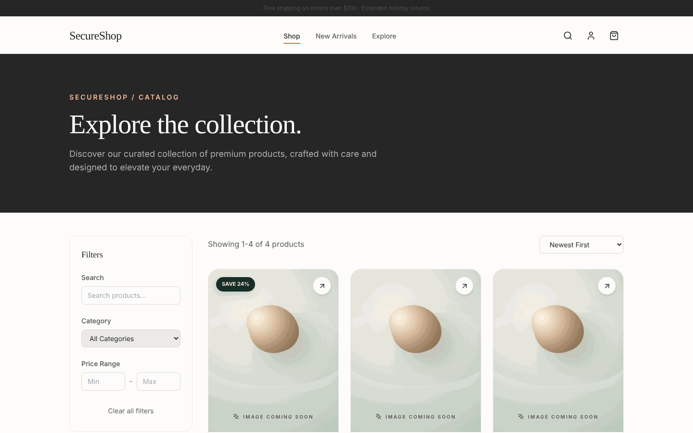
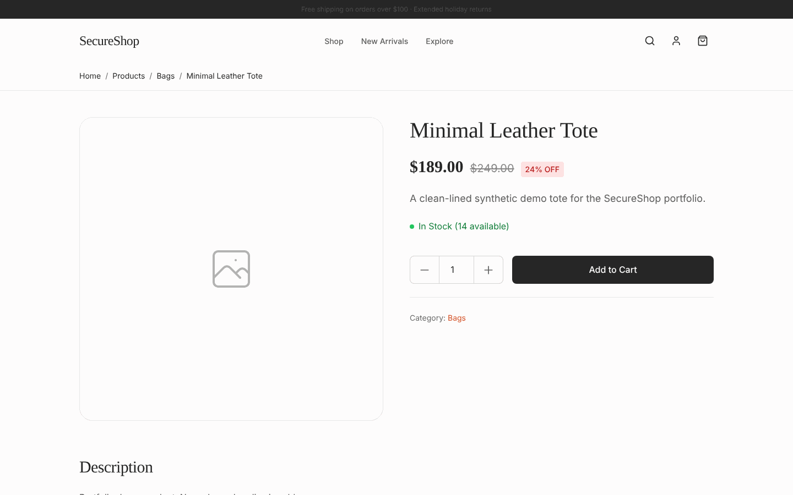
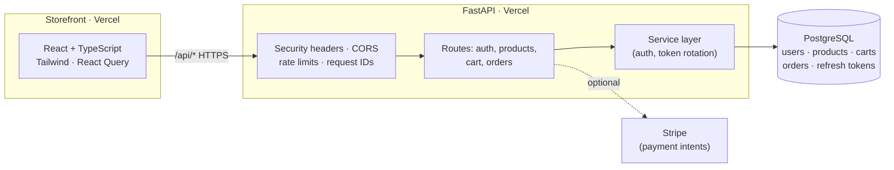

# SecureShop

**A security-first full-stack e-commerce app.** React + TypeScript storefront and a FastAPI/PostgreSQL backend built around the OWASP Top 10: refresh-token rotation with theft detection, constant-time login, RBAC, rate limiting and safe money handling.

[](https://github.com/FarnazNK/secureshop-ecommerce/actions/workflows/ci.yml)
[](https://github.com/FarnazNK/secureshop-ecommerce/actions/workflows/security.yml)

**[🛍️ Live storefront](https://secureshop-storefront.vercel.app)** · **[📦 Catalog](https://secureshop-storefront.vercel.app/products)** · **[📘 API reference](https://secureshop-api.vercel.app/api/reference)** · **[💚 API health](https://secureshop-api.vercel.app/api/v1/health)**



---

## At a glance

| | |
| --- | --- |
| **What it is** | An online store: product catalog with search, filters and sorting, product pages, cart, accounts and orders |
| **Frontend** | React 18, TypeScript, Vite, Tailwind CSS, React Router, React Query |
| **Backend** | Python, FastAPI (async), SQLAlchemy 2.0, PostgreSQL, Alembic, Pydantic v2 |
| **Security** | JWT access + refresh tokens, token rotation with reuse detection, bcrypt, RBAC, rate limiting, CSP/HSTS headers |
| **Quality** | 26 backend tests (pytest) run against real PostgreSQL and Redis in CI, Ruff lint/format, CodeQL, dependency audits |
| **Deployed on** | Vercel (storefront + API) with Neon PostgreSQL |

## What I built

### 🔐 Authentication that handles stolen tokens
Access and refresh tokens are signed with **separate secrets**, and refresh tokens live in **HTTP-only, SameSite cookies**. Every refresh **rotates** the token, and if an already-used token is ever presented again, a sign it was stolen, **every session for that user is revoked**. Login runs bcrypt even when the email doesn't exist, so response timing can't reveal which emails are registered. Repeated failures trigger an account lockout.
→ [`backend/app/services/auth_service.py`](backend/app/services/auth_service.py)

### 🛡️ Hardened API
Security-headers middleware (CSP, HSTS in production, X-Frame-Options, Referrer-Policy, Permissions-Policy), explicit CORS origins, per-IP rate limits that are stricter on auth endpoints, Pydantic validation on every input, and an error handler that never leaks stack traces. Role-based access uses a declarative `require_role("admin")` dependency. The app **refuses to start** if a required secret is missing or shorter than 32 characters.
→ [`backend/app/middleware/`](backend/app/middleware/), [`backend/app/core/config.py`](backend/app/core/config.py)

### 💳 Orders and payments done safely
Money is stored as exact decimals (`Numeric(10, 2)`), never floats. Each order item **snapshots** the product name and price at purchase time, so receipts stay correct if the catalog changes. Card data never touches the database: payments go through **Stripe payment intents** created server-side.
→ [`backend/app/api/v1/orders.py`](backend/app/api/v1/orders.py), [`backend/app/models/`](backend/app/models/)

### 🛍️ Storefront
API-backed catalog with search, category and price filters and sorting kept in the URL (so filtered views are shareable), loading, empty and error states, product pages with stock info, and cart and account flows. Responsive and keyboard accessible.
→ [`frontend/src/pages/`](frontend/src/pages/)

### 🚀 CI/CD
GitHub Actions runs Ruff lint and format checks, applies Alembic migrations to a real **PostgreSQL 16** database, runs pytest with coverage alongside Redis, type-checks and builds the frontend, builds Docker images, and runs **CodeQL** plus dependency audits.
→ [`.github/workflows/`](.github/workflows/)

## Screenshots



## Architecture



Route handlers stay thin; business logic lives in `app/services/`, so it can be tested without an HTTP server. Pydantic schemas (the API contract) are kept separate from SQLAlchemy models (the database), so either can change without breaking the other.

## Run it locally

**With Docker** (Postgres, Redis, API and storefront)
```bash
cp .env.example .env            # fill in secrets: openssl rand -base64 48
docker compose up --build
docker compose run --rm migrate # apply database migrations once
# Storefront: http://localhost:8080 · API docs: http://localhost:3001/api/docs
```

**Without Docker**
```bash
cd backend
make dev && cp .env.example .env   # set DATABASE_URL and secrets
make migrate && make serve         # API on :3001
make test                          # pytest

cd ../frontend
npm install && npm run dev         # storefront on :5173
```

## API

| Area | Endpoints |
| --- | --- |
| Auth | `POST /api/v1/auth/register` · `login` · `refresh` · `logout` · `GET /api/v1/auth/me` |
| Products | `GET /api/v1/products` (filters, pagination) · `GET /{id}` · admin-only `POST` / `PATCH` / `DELETE` |
| Cart | `GET /api/v1/cart` · `POST /items` · `PATCH /items/{id}` · `DELETE /items/{id}` · `DELETE` |
| Orders | `POST /api/v1/orders` (creates a Stripe payment intent) · `GET /api/v1/orders` · `GET /{id}` |
| Health | `GET /api/v1/health` (API and database) |

Full interactive reference: **[secureshop-api.vercel.app/api/reference](https://secureshop-api.vercel.app/api/reference)**

## Honest limitations

This is a portfolio project. Products and data are synthetic, and nothing is really sold.

- **Payments:** live Stripe payments and the payment webhook are not enabled, so orders stay in `PENDING`.
- **Email:** account and order emails aren't sent.
- **Rate limiting:** the hosted limiter is per process. A shared Redis-backed limiter is set up for local Docker but not used in the hosted demo.
- **Frontend tests:** the storefront has no automated UI tests yet. Backend security logic is where the tests focus.

<details>
<summary><strong>Optional extras: AWS AgentCore catalog assistant, Kubernetes, Prometheus/Grafana</strong></summary>

None of these need a paid account.

- **AgentCore catalog assistant:** a disabled-by-default, authenticated assistant that only sees active public product names and short descriptions, never orders, payments or accounts. Run `python aws_agentcore/demo_offline.py`. Security tests run in CI. Details in [`aws_agentcore/PORTFOLIO.md`](aws_agentcore/PORTFOLIO.md). Not deployed to AWS.
- **Kubernetes:** manifests for a local kind cluster (Deployments, ClusterIP Services, a Postgres volume, resource limits), validated in CI. See [`k8s/README.md`](k8s/README.md).
- **Prometheus + Grafana:** local-only HTTP metrics dashboards. See [`k8s/MONITORING.md`](k8s/MONITORING.md).

</details>

## Repository guide

| Path | What's there |
| --- | --- |
| [`backend/app/`](backend/app/) | FastAPI app: routes, services, models, schemas, middleware, security |
| [`backend/tests/`](backend/tests/) | Security, schema, config and database tests |
| [`frontend/src/`](frontend/src/) | React storefront: pages, components, auth and cart context |
| [`.github/workflows/`](.github/workflows/) | CI, security scans, Kubernetes validation |
| [`SECURITY.md`](SECURITY.md) | Security policy |

---

Built by **Farnaz Nasehi** · [LinkedIn](https://www.linkedin.com/in/farnaz-nasehi/) · [GitHub](https://github.com/FarnazNK)
